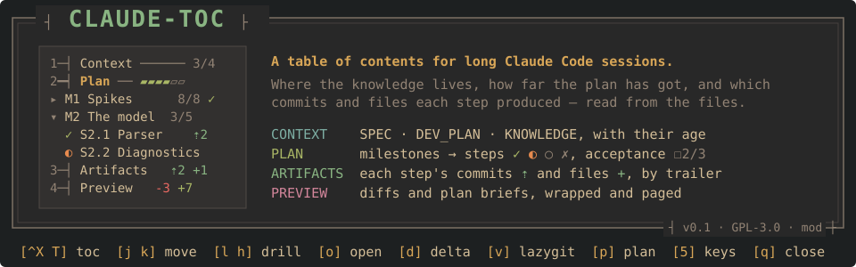
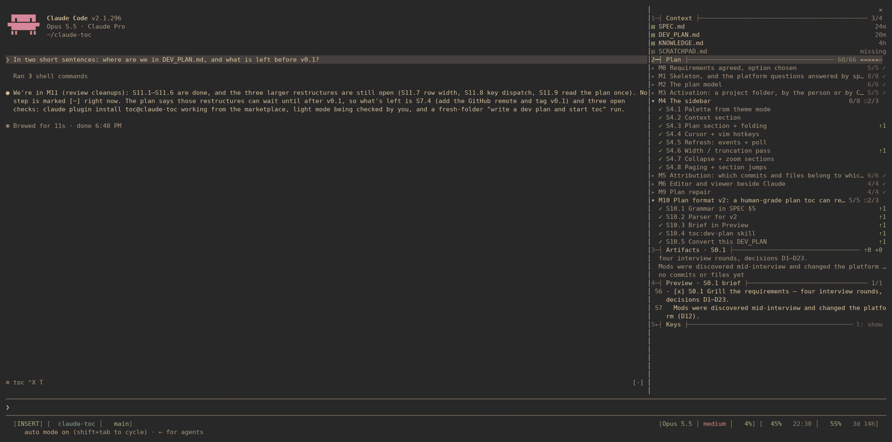
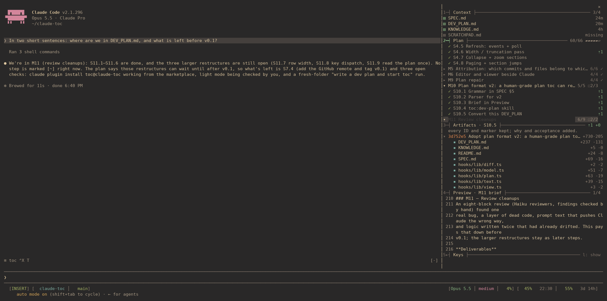
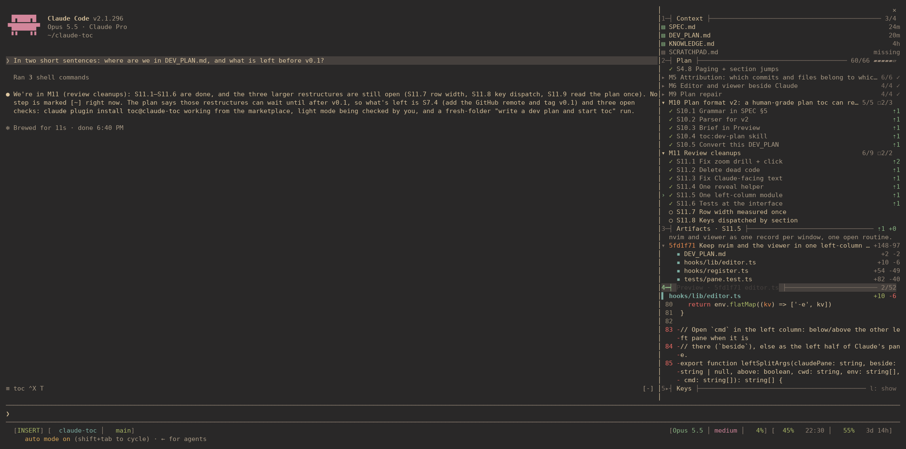
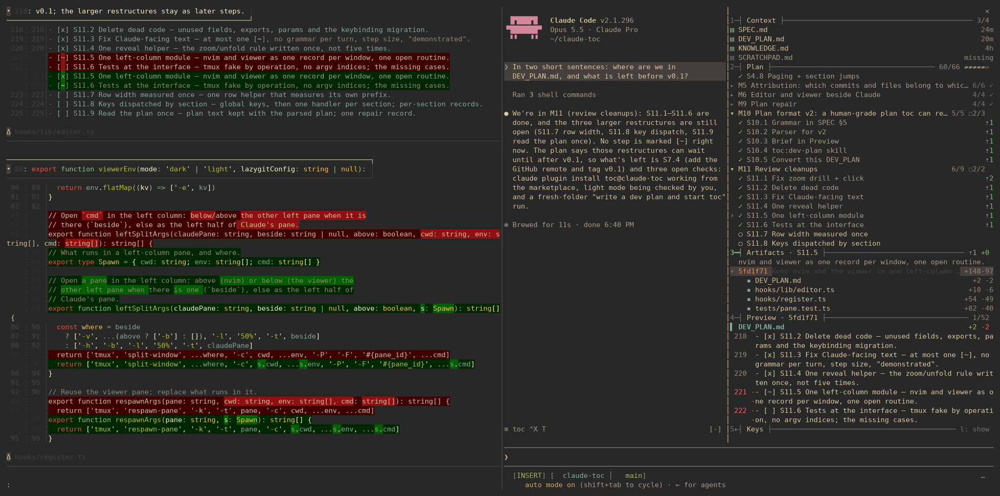
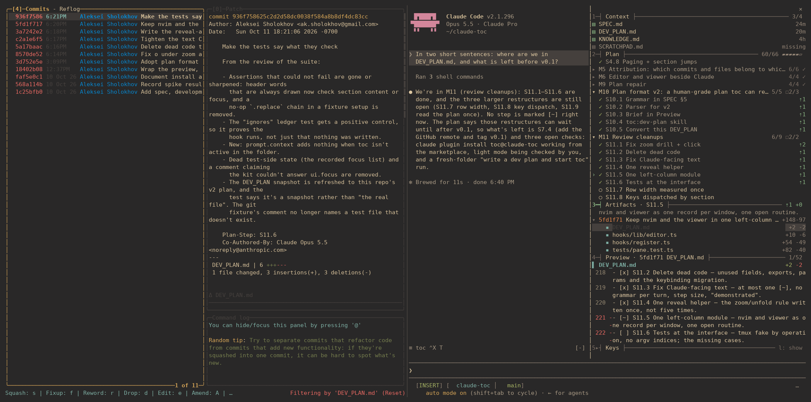
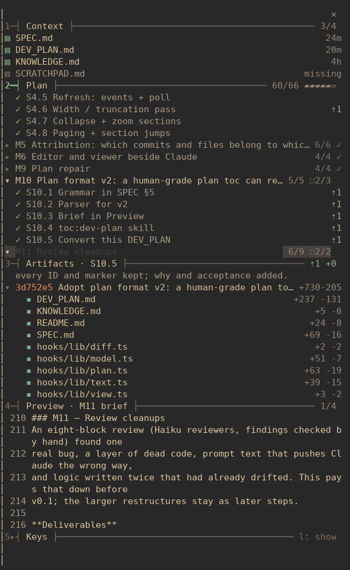
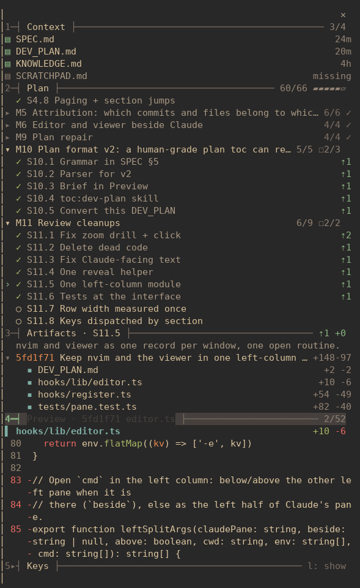

<p align="center">
  
</p>

<p align="center">
  
</p>

<p align="center"><sub>A real session on this repository: the plan's briefs, a step's commit and diff,
delta and lazygit beside Claude, and back. toc itself never calls a model to do any of this.</sub></p>

Long Claude Code sessions lose the plot. Three hours in, the knowledge is spread
over a SPEC, a plan, a findings file and forty commits, and neither you nor
Claude can say at a glance which step you are on or what it produced.

**toc** is a sidebar inside Claude Code that answers exactly that. It reads the
files — never a model — so it can't drift: where the project's knowledge lives,
how far `DEV_PLAN.md` has got, and which commits and files each step produced.

## ┤ What it shows ├

```
┌─┤ THE FIVE SECTIONS ├───────────────────────────────────────────
│ CONTEXT    the knowledge files and their age; missing ones dim
│ PLAN       milestones → steps   ✓ done  ◐ doing  ○ todo  ✗ dropped
│            ⇡ commits per step · ☐ acceptance still open
│ ARTIFACTS  the step's notes, its commits (unfold to files), and the
│            files it touched but hasn't committed yet:  A  M  ✓
│ PREVIEW    the selected diff, or the step's own lines of the plan
│            — its brief — wrapped and paged
│ KEYS       folded to one line until you want them
└─────────────────────────────────────────────────────────────────
```

Commits find their step through a `Plan-Step:` git trailer that toc adds to
Claude's `git commit` while a step is in progress; files find it through a
small ledger of what Claude wrote, edited or changed from Bash. Nothing to
remember, nothing to tag by hand.

## ┤ Look deeper ├

<table>
<tr>
<td width="50%"><br><sub><b>The plan and its brief.</b> Moving through milestones and steps shows each one's own lines of DEV_PLAN.md — its why, deliverables and acceptance — with the file's line numbers.</sub></td>
<td width="50%"><br><sub><b>A step's work.</b> Its commits unfold to files; <code>l</code> on one pages through exactly that file's diff, wrapped to the sidebar.</sub></td>
</tr>
<tr>
<td><br><sub><b>Read a change properly.</b> <code>⏎</code> on a commit opens it in your pager (delta here) in the left half of Claude's tmux pane; <code>q</code> hands the keys back to the sidebar.</sub></td>
<td><br><sub><b>Or its history.</b> <code>v</code> opens lazygit there, filtered to the file under the cursor.</sub></td>
</tr>
<tr>
<td></td>
<td></td>
</tr>
</table>

## ┤ Install ├

```sh
claude plugin marketplace add aksholokhov/claude-toc
claude plugin install toc@claude-toc
```

Then once, in a session: `/toc keys`. It adds `Ctrl+X T` and the optional
`Alt+j/k/h/l` to `~/.claude/keybindings.json`, and never overrides a key you
bound yourself.

- **Claude Code ≥ 2.1.287** with the fullscreen renderer (`"tui": "fullscreen"`)
  for the docked sidebar; narrower windows get it above the prompt. Built and
  tested on v2.1.296.
- **tmux + nvim** to open files beside Claude; **delta** and **lazygit** for the
  diff and history views (plain `less` works without delta).
- Runs on a Claude Pro or Max login: toc is a *mod*, and the only model call it
  ever makes is the optional plan repair (one Haiku run, when you press `y`).

## ┤ Use ├

`/project [dir]` points toc at a project folder — it scaffolds a `DEV_PLAN.md`
if there isn't one and remembers the folder. Claude can do the same itself
(the `mcp__toc__activate` tool) — the bundled skill tells it to, when you ask it
to *write a dev plan and start toc*.

```
┌─┤ KEYS ├────────────────────────────────────────────────────────
│ ^X T    focus the sidebar · again to close    q · Esc   leave
│ 
│ j k     move; flows from one section into the next
│ f b     page                       g e   top · bottom
│ 1 … 5   jump to a section          z     zoom a section
│ l h     drill in / back out: step → Artifacts → Preview
│         (and unfold / fold a milestone or a commit)
│ 
│ o ⏎     open: a file in nvim, a commit as its diff
│ d       the change, in delta       v     its history, in lazygit
│ p       this step in DEV_PLAN.md   5     these keys
│ 
│ ⌥j ⌥k  page   ⌥h ⌥l  section       (terminals that send Alt)
└─────────────────────────────────────────────────────────────────
```

## ┤ The plan ├

A `DEV_PLAN.md` is an engineering document written for people — why, scope,
milestones with deliverables, acceptance criteria and tests, open decisions,
definition of done — of which toc reads a small, fixed part. The bundled
**`toc:dev-plan`** skill teaches Claude to write it well, with the syntax last.
This repo's own [DEV_PLAN.md](DEV_PLAN.md) is a full example.

```markdown
## Milestones
### M2 — What this milestone delivers
Why it exists: what it proves, the risk it retires.     ← the brief

**Deliverables**
- [x] S2.1 Short title — one sentence: the artifact
  indented detail
- [~] S2.2 The one step in progress — …

**Acceptance**
- [ ] A binary, testable statement.        ← counted (☐2/3), never ID'd

**Tests**
1. How it is demonstrated.
```

Step IDs are stable (commits point at them), at most one step is `[~]`, and a
milestone is done only when its steps are done *and* its acceptance is met. If
the file stops parsing, the sidebar offers **Repair? y/n** and a Haiku subagent
fixes it, after backing the file up. Full grammar: [SPEC.md §5](SPEC.md).

## ┤ How it's built ├

A Claude Code [mod](https://code.claude.com/docs/en/plugins/mods): a plugin
whose `hooks/register.ts` holds every call to the host API, over pure,
unit-tested modules in `hooks/lib/` (the plan parser, git and diff parsing, the
sidebar's state and drawing). [SPEC.md](SPEC.md) is the design with its
decision log, [DEV_PLAN.md](DEV_PLAN.md) the plan this sidebar was built with,
[KNOWLEDGE.md](KNOWLEDGE.md) the platform facts learned the hard way.

```sh
claude --plugin-dir .          # run from the working tree (edits hot-reload)
claude plugin validate .       # static checks
claude plugin test             # unit + pane tests, no session needed
```

## ┤ License ├

[GPL-3.0](LICENSE).
